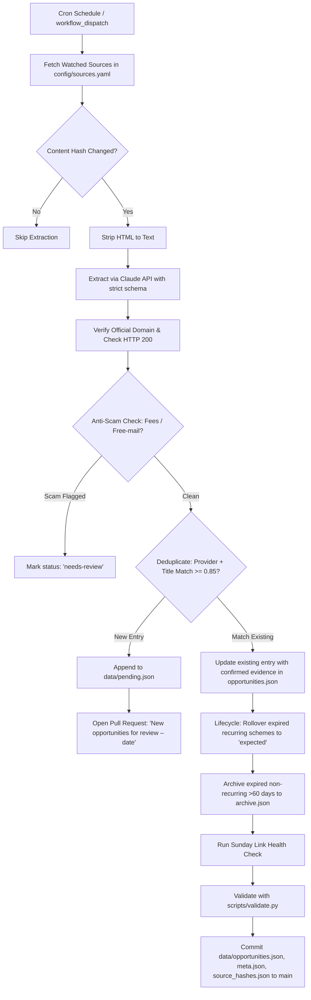

# VidyaSetu - Self-Updating Educational Opportunities Portal 🎓

[](https://github.com/mdsamhussain1996/vidyasetu-scholarship-portal/actions/workflows/validate.yml)
[](https://github.com/mdsamhussain1996/vidyasetu-scholarship-portal/actions/workflows/daily-update.yml)

**VidyaSetu** is an open, self-updating opportunities portal tailored specifically for **Indian students** across five educational stages: **After 12th, Bachelor's, Master's, PhD, and Postdoc**.

It aggregates, verifies, and daily monitors **185+ opportunities**:
- 🏛️ **Central & State Government Schemes** (NSP Central Sector & Top Class, INSPIRE SHE, PMRF, AICTE Pragati/Saksham/Swanath, CSIR-UGC NET, DBT BET, ICMR JRF, ANRF N-PDF & Ramanujan, MahaDBT, Karnataka SSP, WB SVMCM, Bihar PMS, UP, Telangana ePASS, etc.)
- 💼 **Private & Corporate Philanthropic Trusts** (Tata Trusts, Reliance Foundation UG & PG, Aditya Birla, HDFC Badhte Kadam, Kotak Kanya, L'Oréal For Young Women in Science, Sitaram Jindal, Santoor, Siemens, Amazon Future Engineer, etc.)
- 🔬 **Real Project Positions (JRF / SRF / RA / Project Associate)** (Currently advertised vacancies at IIT Bombay, IIT Delhi, IIT Madras, IIT Kharagpur, IIT Roorkee, IIT Kanpur, IIT Hyderabad, IISc, IISERs, NITs, CSIR-NCL, CSIR-CCMB, CSIR-IGIB, THSTI, ICMR-NIV, etc.)
- 🌍 **Fully Funded Global Opportunities** (Erasmus Mundus, Chevening, Commonwealth, Fulbright-Nehru, DAAD WISE & Helmut-Schmidt, MEXT Japan, Mitacs Globalink, CERN, Gates Cambridge, Rhodes Oxford, Eiffel France, Swiss Govt Excellence, Australia Awards, etc.)

---

## 🌟 Live Portal

- **Live Website**: [https://mdsamhussain1996.github.io/vidyasetu-scholarship-portal/](https://mdsamhussain1996.github.io/vidyasetu-scholarship-portal/)
- **Repository**: [https://github.com/mdsamhussain1996/vidyasetu-scholarship-portal](https://github.com/mdsamhussain1996/vidyasetu-scholarship-portal)

---

## 📊 Dataset Statistics & Honest Audit

Every opportunity is cataloged with strict provenance:
- **Total Active Opportunities**: `187`
- **Confirmed Current-Cycle Dates**: `51` (verified against official circulars with quoted evidence and deep links)
- **Expected / Historical Cycles**: `136` (tentative month ranges, e.g. "Usually Oct–Dec")
- **Project Positions (JRF/SRF/RA)**: `33` active advertised positions
- **Opportunities in India**: `126` | **Opportunities Abroad**: `61`
- **Government Schemes**: `113` | **Private / CSR**: `30` | **University / Lab Positions**: `44`
- **Link Quality**: Deep links to scheme call pages / guidelines rather than bare homepages; ANRF migration completed.

> [!NOTE]
> **Data Integrity Notice**: All legacy synthetic generator scripts have been permanently retired to `archive_legacy_scripts/` so they can never overwrite verified data.

---

## 🛡️ "Confirmed" vs "Expected": How Date Confidence Works

A wrong "Open" badge misleads students and leads to missed deadlines. VidyaSetu enforces strict status badge rules:

| `dateConfidence` | Condition | Badge Display | Meaning |
|---|---|---|---|
| **`confirmed`** | Today is between confirmed `openDate` and `deadline` | 🟢 **Open · closes YYYY-MM-DD** | Verified from provider's official notification. Included in "Closing Soon" and Deadline Calendar. |
| **`confirmed`** | Today is before confirmed `openDate` | 🔵 **Opens YYYY-MM-DD** | Officially scheduled upcoming round. |
| **`confirmed`** | Confirmed deadline has passed | 🔴 **Closed · next round expected <window>** | Current round closed; next expected cycle displayed. |
| **`expected`** | Unconfirmed for current round | ⚪ **Expected: <deadlineText>** *(e.g. Usually Oct–Dec)* | **NEVER marked "Open"**. Historical estimate based on previous annual cycles. |
| **`unknown`** | No reliable cycle known | ⚪ **Check official site** | Student advised to check official portal. |

- **"Verified <n> days ago"**: Displayed **only** when `lastVerified` is non-null. Otherwise displays `"Not yet verified for this cycle"`.
- **Closing Soon Strip & Calendar**: Exclusively populated by entries with `dateConfidence: "confirmed"`.

---

## 🤖 How the Auto-Update & Discovery Pipeline Works

VidyaSetu is hosted on GitHub Pages without a paid database. Daily discovery, verification, and lifecycle management run through a scheduled GitHub Actions workflow (`.github/workflows/daily-update.yml` at 02:30 UTC ≈ 08:00 IST).



### 1. Watched Source Change Detection
Monitors 30+ official portals in `config/sources.yaml` (NSP, DST INSPIRE, PMRF, AICTE, CSIR, ANRF, IIT/IISc/IISER/CSIR career pages, DAAD, Chevening, Erasmus Mundus, etc.). Computes SHA-256 hashes stored in `data/source_hashes.json`. Only modified pages trigger extraction.

### 2. Search Query Rotation & Extraction
Rotates through queries in `config/search_queries.yaml` (e.g., `"project JRF IIT 2026"`, `"NSP new scholarship 2026"`, `"postdoctoral fellowship India"`). When `ANTHROPIC_API_KEY` is provided, candidate text is sent to the Claude API with a strict extraction prompt requiring exact quotes in the `evidence` field.

### 3. Verification & Anti-Scam Rules
- **Official Domain Whitelist**: `officialLink` must be on `.gov.in`, `.nic.in`, `.ac.in`, `.res.in`, `.edu`, or provider domains. Aggregators (Buddy4Study, etc.) are restricted to `sourceUrl` only.
- **Link Quality**: `validate.py` warns if an `officialLink` has an empty path (homepage) or if multiple schemes share the same link without distinct `guidelinesLink`.
- **Anti-Scam Filter**: Flagged as `status: "needs-review"` if asking for application/registration fees, promising "guaranteed selection", or using free-mail contact addresses (`@gmail.com`, `@yahoo.com`).

### 4. Lifecycle Rollover (No Fabricated Dates)
When a recurring scheme's deadline passes:
- `deadline` and `openDate` are cleared (`null`).
- `dateConfidence` is set to `"expected"`.
- `lastVerified` is **kept untouched** (preserves the date human/bot actually verified the page).
- Leap years (Feb 29) are handled safely.

### 5. Sunday Link Health Check
Every Sunday (or via `python scripts/discover.py --check-links`), official links are verified for HTTP 200. Any broken links are flagged `status: "needs-review"` and tracked in `meta.json`.

---

## 🔑 GitHub Secrets Configuration

To enable LLM extraction and web discovery in GitHub Actions:
1. Go to repository **Settings** > **Secrets and variables** > **Actions**.
2. Add a new repository secret:
   - **Name**: `ANTHROPIC_API_KEY`
   - **Value**: Your Anthropic API Key (`sk-ant-...`)

> [!TIP]
> If `ANTHROPIC_API_KEY` is missing or empty, the pipeline fails gracefully: watched page change detection, link validation, lifecycle rollover, and metadata updates continue running without interrupting live data.

---

## 🔍 How to Review and Merge the Daily PR

When new opportunities are discovered, they are placed in `data/pending.json` and a pull request is automatically opened with title `New opportunities for review – <YYYY-MM-DD>`:

1. **Inspect `data/pending.json`**:
   - Verify that the `officialLink` leads to the provider's official guidelines or application form.
   - Confirm eligibility, level, and that students are never charged a registration fee.
2. **Promote to Live**:
   - Move approved entries from `data/pending.json` into `data/opportunities.json`.
   - Set `"verifiedBy": "human"`, `"confidence": 1.0`, and `"dateConfidence": "confirmed"`.
   - Empty `data/pending.json` (`[]`).
3. **Verify Integrity**:
   ```bash
   python3 scripts/validate.py
   python3 -m unittest discover tests
   ```
4. **Merge the PR**: Once merged to `main`, GitHub Pages automatically updates the live portal.

---

## ➕ How to Add a Source or Search Query

### Add a Monitored Official Portal:
Edit [`config/sources.yaml`](file:///Users/newtonuser/.gemini/antigravity-ide/scratch/scholarship-portal/config/sources.yaml):
```yaml
  - name: "IIT Madras Project Staff Openings"
    url: "https://icandsr.iitm.ac.in/recruitment/"
    kind: "university"
    provider_slug: "iit-madras"
    section: "india"
```

### Add a Discovery Query:
Edit [`config/search_queries.yaml`](file:///Users/newtonuser/.gemini/antigravity-ide/scratch/scholarship-portal/config/search_queries.yaml):
```yaml
  - query: "SRF project position IIT Kanpur 2026"
    category: "Project Position (JRF/SRF/RA)"
    section: "india"
    frequency: "daily"
```

---

## 🧪 Local Testing & Validation

Run the validation suite:
```bash
# Validate schema conformance, HTTPS links, and link quality
python3 scripts/validate.py

# Run unit tests (rollover, deduplication, scams, badges)
python3 -m unittest discover tests
# or with pytest:
python3 -m pytest tests/
```

Run discovery pipeline locally:
```bash
python3 scripts/discover.py

# To force link health check:
python3 scripts/discover.py --check-links
```

Start local preview server:
```bash
python3 -m http.server 8089
```
Open [http://localhost:8089](http://localhost:8089) in your browser.

---

## 👨‍🏫 Author & Founder
Created and maintained by **Md Samshad Hussain Ansari**, Assistant Professor of Mathematics, Pune.  
Portfolio & Personal Website: [https://mdsamhussain1996.github.io/](https://mdsamhussain1996.github.io/)

---

## 📜 License
MIT License • Dedicated to student educational access and research welfare in India.

