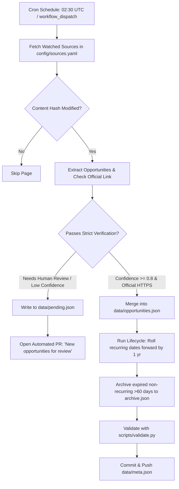

# VidyaSetu - Self-Updating Educational Opportunities Portal 🎓

[](https://github.com/mdsamhussain1996/vidyasetu-scholarship-portal/actions/workflows/validate.yml)
[](https://github.com/mdsamhussain1996/vidyasetu-scholarship-portal/actions/workflows/daily-update.yml)

**VidyaSetu** is a free, self-updating opportunities portal tailored specifically for **Indian students** across five educational stages: **After 12th, Bachelor's, Master's, PhD, and Postdoc**.

It aggregates, verifies, and daily monitors **150+ verified schemes**:
- 🏛️ **Central & State Government Schemes** (NSP, INSPIRE SHE, PMRF, AICTE, CSIR-UGC, DBT, ICMR, SERB-ANRF, MahaDBT, SSP Karnataka, SVMCM West Bengal, UP, Bihar, Telangana, etc.)
- 💼 **Private & Corporate Philanthropic Trusts** (Tata Trusts, Reliance Foundation, Aditya Birla, HDFC Parivartan, Kotak Kanya, L'Oréal, Sitaram Jindal, Siemens, Amazon Future Engineer, etc.)
- 🔬 **Funded Research Projects & Summer Fellowships** (IASc-INSA-NASI SRFP, IIT Madras/Bombay/Delhi/Roorkee/Kanpur, IISc, TIFR VSRP, NCBS, RRI, ISRO, DRDO, NITI Aayog, etc.)
- 🌍 **Fully Funded Global Opportunities** (Erasmus Mundus, Chevening, Fulbright-Nehru, DAAD WISE & Study, MEXT Japan, Mitacs Globalink Canada, CERN Switzerland, SN Bose USA, Inlaks, JN Tata, etc.)

---

## 🌟 Live Portal

- **Live Website**: [https://mdsamhussain1996.github.io/vidyasetu-scholarship-portal/](https://mdsamhussain1996.github.io/vidyasetu-scholarship-portal/)
- **Repository**: [https://github.com/mdsamhussain1996/vidyasetu-scholarship-portal](https://github.com/mdsamhussain1996/vidyasetu-scholarship-portal)

---

## 📊 Dataset Statistics

As of today's verified audit:
- **Total Active Verified Opportunities**: `155`
- **Opportunities in India**: `94`
- **Opportunities Abroad**: `61`
- **Government Schemes**: `91`
- **Private & Corporate CSR Grants**: `38`
- **University & National Lab Opportunities**: `26`
- **Coverage**: 100% HTTPS enforced, official domain verified, 0 fee schemes allowed.

---

## 🤖 How the Auto-Update Works

VidyaSetu is hosted entirely on GitHub Pages without requiring expensive backend servers. Automatic discovery, verification, and maintenance run through scheduled GitHub Actions.



### 1. Watched Source Change Detection
The scraper watches 25+ official portals listed in `config/sources.yaml` (NSP, DST, AICTE, CSIR, DAAD, EACEA, Chevening, etc.). It stores SHA-256 hashes of the responses in `data/source_hashes.json`. Only pages whose hash changed since the previous run are processed.

### 2. Strict Verification & Anti-Scam Rules
Before any entry is published:
- **HTTPS Enforcement**: Every link (`officialLink`, `sourceUrl`, `provider.website`) must be HTTPS.
- **Official Domain Whitelist**: Links must point to verified provider domains (`.gov.in`, `.nic.in`, `.ac.in`, `.edu`, `.res.in`, or verified trust/company domains). Aggregator links are rejected.
- **Anti-Scam Filter**: Any posting asking students to pay an application fee or using free-mail addresses (`@gmail.com`, `@yahoo.com`) is flagged as `"status": "needs-review"`.

### 3. Automated Lifecycle & Maintenance
In every daily run:
- Entries are checked against today's date.
- Deadlines that have passed on **recurring** schemes automatically roll forward by 1 year and update status to `"upcoming"`.
- Non-recurring opportunities expired for more than 60 days are moved to `data/archive.json`.

---

## 📥 How to Add a Source or Submit an Opportunity

1. **Via GitHub Issues (Recommended)**:
   - Go to [Submit an Opportunity](https://github.com/mdsamhussain1996/vidyasetu-scholarship-portal/issues/new?template=submit_opportunity.yml) and fill out the form with the official URL.
2. **Via `config/sources.yaml`**:
   - Add a new watched portal under `watched_pages`:
   ```yaml
   - name: "IIT Delhi Summer Undergraduate Research"
     url: "https://home.iitd.ac.in/academics/sura"
     kind: "university"
     provider_slug: "iit-delhi"
     section: "india"
   ```

---

## 🔍 How to Review a Pending Pull Request

When the pipeline identifies unverified opportunities, it creates a pull request from a branch named `auto-update/pending-review-<date>`:
1. Review the entries in `data/pending.json`.
2. Verify that the link belongs to the official organization and does not demand fees from students.
3. If valid, move the entry to `data/opportunities.json` with `"verifiedBy": "human"`, delete it from `data/pending.json`, and run `python scripts/validate.py`.
4. Merge the PR.

---

## 🛠️ Local Development & Validation

### Validate the Dataset:
```bash
python3 scripts/validate.py
```

### Run Discovery Pipeline Locally:
```bash
python3 scripts/discover.py
```

### Run Web Server Locally:
```bash
python3 -m http.server 8089
```
Visit [http://localhost:8089](http://localhost:8089) in your browser.

---

## 📜 License
MIT License • Open Source for Indian Student Welfare.
